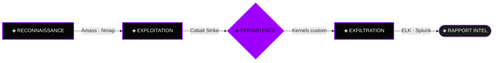
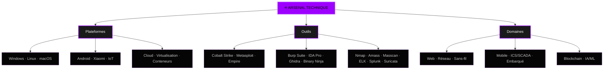
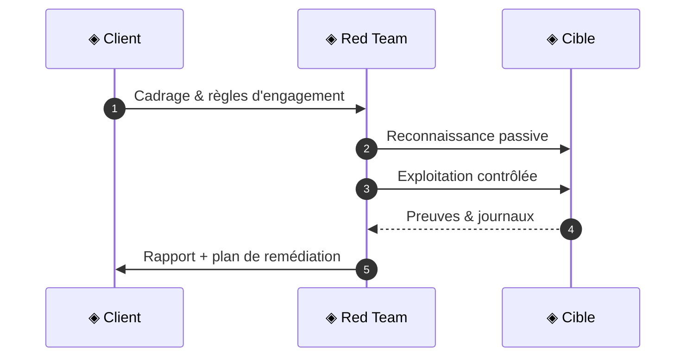

<div align="center">

# "TheMadDoG.tmdg"

### — Opérateur offensif · Red Team · Threat Intelligence


> ⟢ **** · Présentation · Sécurité offensive & défense avancée

</div>

---

## Sommaire

| ◈ | Module | Sujet |
|:--|:-------|:------|
| **0x00** | [Synthèse opérationnelle](#0x00-synthèse-opérationnelle) | Positionnement, discipline, périmètre |
| **0x01** | [Identité & habilitations](#0x01-identité--habilitations) | Badges cyber-physiques, clearance |
| **0x02** | [Cycle d'attaque](#0x02-cycle-dattaque) | Schéma Mermaid des phases offensives |
| **0x03** | [Arsenal technique](#0x03-arsenal-technique) | Plateformes, outils, domaines |
| **0x04** | [Registre des opérations](#0x04-registre-des-opérations) | Projets et statuts |
| **0x05** | [Validation & logs](#0x05-validation--logs) | Réalisations, CVE, hall of fame |
| **0x06** | [Communications sécurisées](#0x06-communications-sécurisées) | Contact & template de PR |
| **0x07** | [Signature](#0x07-signature) | Phrase finale |

---

## 0x00 Synthèse opérationnelle

> **Légende** — Chaque module de ce dossier documente une capacité vérifiable, de la reconnaissance initiale jusqu'à la restitution d'un rapport de renseignement.

*Architecte d'entropie numérique*.
- Expertise dans les paysages de menaces avancées, les manœuvres de sécurité offensive et les opérations Red Team. Le travail relie la vulnérabilité matérielle à l'exploitation logicielle sur **Windows, Linux, macOS, Android et Xiaomi**, ainsi que sur les infrastructures **Cloud & IoT**.

> ❯ **Discipline centrale :** *traduire une vulnérabilité complexe en avantage stratégique.*

| Domaine | Périmètre |
|:--|:--|
| 🜏 **Adversary Emulation** | Scénarios Red Team alignés MITRE ATT&CK |
| 🧬 **Exploit Dev & Reverse** | Analyse binaire, fuzzing, développement d'exploits |
| 🛡️ **Architecture défensive** | Durcissement, segmentation, zero trust |
| 🕸️ **Vulnerability Research** | Chasse aux zero-day & analyse de malware |
| ⚙️ **Systèmes critiques** | Embarqué, IoT, ICS/SCADA, environnements durcis |

---

## 0x01 Identité & habilitations

> **Légende** — Badges cyber-physiques : chaque pastille agrège un statut d'habilitation. Le bouclier encode le niveau d'accréditation (**L7**) et le domaine d'opération (**adversaire**).

```text
┌───────────────────────────────┐
│  ◈ CLEARANCE : L7 · ADVERSARY │
│  ◈ STATUS    : OPERATIONAL    │
│  ◈ THREAT    : FEED LIVE      │
└───────────────────────────────┘
```

**Windows** · **Linux** · **macOS** · **Android** · **Xiaomi** · **Cloud** · **IoT** · **Virtualisation** · **Conteneurs**

---

## 0x02 Cycle d'attaque

> **Légende** — Les nœuds sombres sont des phases de collecte, le nœud mauve plein marque le point de bascule (persistance), le nœud clair la restitution. Les étiquettes de liaison indiquent l'outillage employé.



> **Lecture** — Chaque phase produit une preuve exploitable : la reconnaissance alimente l'exploitation, la persistance sécurise l'accès, l'exfiltration nourrit le rapport.

---

## 0x03 Arsenal technique

> **Légende** — Le diagramme se lit de la racine (arsenal) vers les feuilles (compétences concrètes) : plateformes à gauche, outillage au centre, domaines d'intervention à droite.



### 🖥️ Plateformes maîtrisées

`Windows` · `Linux` · `macOS` · `Android` · `Xiaomi` · `Cloud` · `IoT` · `Virtualisation` · `Conteneurs`

### 🧰 Outils principaux

`Metasploit` · `Cobalt Strike` · `Burp Suite` · `Empire` · `ELK` · `Splunk` · `Suricata`
`IDA Pro` · `Ghidra` · `Binary Ninja` · `Nmap` · `Amass` · `Masscan` · `Scripts custom`

### 🌐 Domaines d'expertise

`Web` · `Réseau` · `Sans-fil` · `Cloud` · `Mobile` · `ICS/SCADA` · `Blockchain` · `Embarqué` · `IA/ML`

### 🎯 Compétences clés
```markdown
- Tests d'intrusion avancés : Web, Réseau, Cloud, Mobile, IoT, ICS/SCADA
- Opérations Red Team & campagnes d'émulation d'adversaires
- Reverse engineering, exploit dev, fuzzing
- Threat hunting & forensic numérique
- Cyber Threat Intelligence & architecture défensive
- Automatisation : DevSecOps, CI/CD, SOAR
- Sécurité Blockchain, Smart Contracts, IA/ML, systèmes embarqués
```

---

## 0x04 Registre des opérations

> **Légende** — `Statut` indique la phase de vie du projet ; l'identifiant de classification précise la nature du livrable (framework, recherche, automatisation, audit).

| ◈ Identifiant | Classification | Objectif de mission | Statut |
|:--|:--|:--|:--|
| **ShadowStrike** | `FRAMEWORK` | Framework d'opérations Red Team (C2, payloads, post-exploitation) | 🟣 **Actif** |
| **ZeroDay-Lab** | `RESEARCH` | Recherche & exploitation de vulnérabilités | 🧪 **Research** |
| **CTF-Mastermind** | `TRAINING` | Défis CTF personnalisés | 🔄 **En cours** |
| **ReconX** | `AUTOMATION` | Plateforme de reconnaissance automatisée | 🟡 **Bêta** |
| **SmartContract-Sentinel** | `AUDIT` | Sécurité Blockchain & Smart Contracts | 🔵 **Stable** |

---

## 0x05 Validation & logs

> **Légende** — Chronologie de crédibilité : chaque entrée correspond à une validation externe (conférence, CVE, programme de bug bounty, compétition).



- 🏆 **Black Hat / DEFCON** — Intervenant & chercheur sécurité
- 🧨 **Zero-day archive** — Publication d'exploits et de CVE
- 🜏 **Hall of Fame** — Apple · Google · Microsoft · Meta
- ⚔️ **CTF** — Vainqueur de compétitions offensives
- 🛠️ **Tooling** — Concepteur d'outils de sécurité avancés

---

## 0x06 Communications sécurisées

> **Légende** — Aucun canal public n'est exposé : toute demande passe par une pull request tracée, ce qui garantit un historique et une validation.

```text
❯ tmdg --initiate-handshake
[ OK ] clé publique échangée
[ OK ] canal chiffré établi
❯ objectif: collaboration / audit / red team
```

**Template de PR** — à placer dans `.github/PULL_REQUEST_TEMPLATE.md` :

## ⟢ Contexte
* *Décris la demande : audit, collaboration, recherche, outillage*

## ◈ Périmètre
- [x] Cible / dépôt concerné
- [x] Règles d'engagement définies
- [x] Fenêtre temporelle validée

## 🛡️ Sécurité
- [x] Aucune donnée sensible dans cette PR
- [x] Divulgation responsable respectée

## ❯ Notes
* *Contexte additionnel, références, CVE liées*

---

## 0x07 Signature

<div align="center">

**Opérationnel dans les ombres numériques.**

`SYSTEM_MESSAGE :: HACK THE PLANET // 2026`

⟢ ⚡ ⟢

</div>
