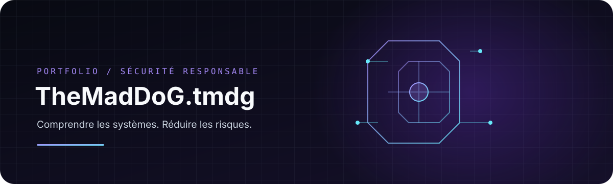
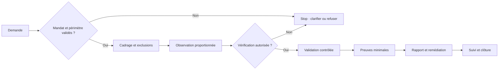

# ⟢ TheMadDoG.tmdg
### Portfolio sécurité · Red Team autorisée · Threat Intelligence

**Comprendre les systèmes. Réduire les risques. Rendre chaque résultat vérifiable.**

[🚀 Visiter le portfolio](https://teremuhamblin.github.io/README/) · [Voir l’architecture](docs/ARCHITECTURE.md) · [Guide de déploiement](docs/DEPLOIEMENT.md) · [Projets](docs/PROJETS.md)

> **À propos de ce dépôt :** `index.html` est l’interface web principale, autonome, responsive et construite avec HTML, CSS et JavaScript intégrés. Ce README sert de porte d’entrée, de résumé textuel accessible et d’index vers les ressources du projet.

---

## ◈ Navigation

| ID | Section du site | Ancre |
|:--:|:--|:--|
| `00` | Synthèse | [`#synthese`](https://teremuhamblin.github.io/README/#synthese) |
| `01` | Identité | [`#identite`](https://teremuhamblin.github.io/README/#identite) |
| `02` | Cycle de travail | [`#cycle`](https://teremuhamblin.github.io/README/#cycle) |
| `03` | Arsenal | [`#arsenal`](https://teremuhamblin.github.io/README/#arsenal) |
| `04` | Registre des projets | [`#operations`](https://teremuhamblin.github.io/README/#operations) |
| `05` | Validation | [`#validation`](https://teremuhamblin.github.io/README/#validation) |
| `06` | Collaboration | [`#communications`](https://teremuhamblin.github.io/README/#communications) |

> **Légende :** les ancres suivent les identifiants de section du site. Les statuts et exemples restent déclaratifs tant qu’ils ne sont pas corroborés par des preuves publiques autorisées. Les badges décoratifs ne constituent ni habilitation ni certification.

---

## ◈ Manifeste

Ce portfolio rassemble des axes de pratique en sécurité des systèmes, recherche, émulation d’adversaire et amélioration défensive. L’approche privilégie un mandat explicite, un périmètre borné, une validation proportionnée et une restitution utile.

> **Principe directeur :** travailler uniquement avec autorisation et transformer les constats en recommandations vérifiables.

Le site propose un thème sombre et clair, une navigation adaptée aux petits écrans, des repères visuels et des animations discrètes. Les préférences et comportements du navigateur peuvent influer sur l’affichage.

## ◈ Principes opérationnels

| Principe | Application |
|:--|:--|
| **Autorisation d’abord** | Accord explicite et règles d’engagement définis avant toute activité. |
| **Périmètre borné** | Cibles, comptes, environnements, calendrier et exclusions consignés. |
| **Impact minimal** | Approche non destructive et arrêt en cas d’effet inattendu. |
| **Données protégées** | Aucune donnée sensible dans les contenus publics ; collecte minimale. |
| **Divulgation responsable** | Coordination avec les responsables concernés avant publication. |
| **Résultats vérifiables** | Constats, limites et recommandations clairement documentés. |

> **Garde-fou :** la présentation d’un outil ou d’une technique n’autorise pas son utilisation sur un système tiers. Voir la [politique de sécurité](docs/SECURITE.md).

## ◈ Méthode

Le site illustre un cycle allant du cadrage à la restitution. Une activité s’arrête si l’autorisation, le périmètre ou les règles ne sont pas suffisamment clairs. Le schéma n’est pas une procédure technique d’intrusion.

> **Légende :** les losanges représentent les contrôles d’autorisation. Le chemin `Stop` signifie qu’aucun test ne continue sans clarification.

## ◈ Domaines et outils

Axes décrits par le portfolio : sécurité applicative, recherche en laboratoire, rétro-ingénierie, émulation d’adversaire, architecture défensive, renseignement sur les menaces, cloud, mobile et systèmes embarqués.

Les outils listés sur le site sont regroupés par usage : analyse réseau et inventaire autorisé, tests applicatifs, analyse binaire, télémétrie/détection et environnements de formation. Leur présence ne décrit pas une procédure d’exploitation.

## ◈ Registre des projets

| Projet | Orientation | Statut présenté sur le site |
|:--|:--|:--|
| ShadowStrike | Framework de laboratoire | Actif — à confirmer par des livrables liés |
| ZeroDay-Lab | Recherche en environnement dédié | Research |
| CTF-Mastermind | Formation et défis de compétition | En cours |
| ReconX | Automatisation d’inventaire autorisé | Bêta |
| SmartContract-Sentinel | Revue de contrats intelligents | Stable |

> **Légende — statut :** ces états proviennent du contenu du site et ne sont pas une validation indépendante. Pour les fiches et les limites, consulter [l’index des projets](docs/PROJETS.md).

## ◈ Accessibilité et expérience

Le site inclut des éléments d’accessibilité tels qu’un lien d’accès direct au contenu, une navigation balisée, des états de focus visibles et la prise en compte de la préférence de réduction des animations. Ces éléments doivent être vérifiés au fil des changements, notamment au clavier et sur mobile.

## ◈ Documentation

- [Architecture du site](docs/ARCHITECTURE.md) — structure et fonctionnalités de `index.html`.
- [Guide de déploiement](docs/DEPLOIEMENT.md) — publication sur GitHub Pages.
- [Fiches projets](docs/PROJETS.md) — description, périmètres et limites.
- [Charte visuelle](docs/CHARTE_VISUELLE.md) — palette et règles de présentation.
- [Politique de sécurité](docs/SECURITE.md) — confidentialité et divulgation.
- [Feuille de route](docs/ROADMAP.md) — améliorations prévues.
- [Contribution](CONTRIBUTING.md) — règles de modification.
- [Structure du dépôt](structure.md) — arborescence et historique.

**Penser comme un adversaire. Travailler avec autorisation. Livrer pour mieux défendre.**

[Ouvrir le portfolio web](https://teremuhamblin.github.io/README/)

