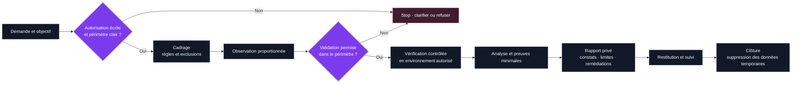

# ⟢ TheMadDoG.tmdg
### Portfolio sécurité · Red Team autorisée · Threat Intelligence

**Comprendre les systèmes. Réduire les risques. Rendre chaque résultat vérifiable.**

*Un portfolio est une interface : il doit rendre les compétences lisibles, les limites explicites et les preuves faciles à vérifier.*

[Explorer les domaines](#-domaines) · [Voir la méthode](#-méthode--du-mandat-à-la-remédiation) · [Parcourir les projets](#-registre-des-projets) · [Lire la documentation](docs/README.md)

---

## ◈ Navigation

| ID | Section | Repère |
|:--:|:--|:--|
| `00` | [Manifeste](#-manifeste) | Positionnement et intention |
| `01` | [Principes opérationnels](#-principes-opérationnels) | Autorisation, limites et protection des données |
| `02` | [Méthode](#-méthode--du-mandat-à-la-remédiation) | Cycle de travail contrôlé |
| `03` | [Domaines](#-domaines) | Axes de pratique et environnements |
| `04` | [Boîte à outils](#-boîte-à-outils) | Outils classés par usage |
| `05` | [Registre des projets](#-registre-des-projets) | Projets et statut indicatif |
| `06` | [Preuves & références](#-preuves--références) | Comment évaluer le travail |
| `07` | [Collaboration](#-collaboration) | Demandes, périmètre et divulgation |
| `08` | [Documentation](#-documentation-du-dépôt) | Organisation du dépôt |

> **Légende — lecture rapide :** `◈` identifie une section de référence ; les statuts sont indicatifs et doivent être corroborés par les dépôts, démonstrations ou publications liés. Aucun badge ne constitue une accréditation officielle.

---

## ◈ Manifeste

J’explore la sécurité des systèmes avec une approche qui relie **recherche**, **émulation d’adversaire** et **amélioration défensive**. L’objectif n’est pas l’intrusion pour elle-même : c’est de transformer une question de sécurité en constat reproductible, compréhensible et utile à la remédiation.

> **Principe directeur :** travailler uniquement avec une autorisation explicite, sur un périmètre défini, et produire des résultats proportionnés et vérifiables.

Ce portfolio présente des axes de travail et des projets. Les affirmations de résultats, de classement ou de reconnaissance externe doivent être accompagnées d’une référence publique consultable avant d’être considérées comme vérifiées.

---

## ◈ Principes opérationnels

| Principe | Application |
|:--|:--|
| **Autorisation d’abord** | Accord explicite et règles d’engagement définis avant toute activité. |
| **Périmètre borné** | Cibles, comptes, environnements, calendrier et exclusions consignés. |
| **Impact minimal** | Approche non destructive ; arrêt immédiat en cas d’effet inattendu ou de risque pour un tiers. |
| **Données protégées** | Collecte minimale, stockage contrôlé, absence de secrets et de données personnelles dans les livrables publics. |
| **Divulgation responsable** | Coordination avec les responsables concernés et publication seulement lorsque cela est approprié. |
| **Résultats vérifiables** | Constats documentés, limites indiquées et recommandations exploitables. |

> **Légende — garde-fou :** la présence d’un outil ou d’une technique dans ce portfolio n’autorise pas son utilisation contre un système tiers. Les travaux se limitent aux environnements détenus, aux laboratoires ou aux périmètres explicitement autorisés.

---

## ◈ Méthode — du mandat à la remédiation

Le schéma ci-dessous décrit un processus de validation contrôlée. Le point de décision est volontairement placé avant toute vérification active : sans autorisation et périmètre validés, le travail s’arrête.

> **Légende — cycle :** les losanges sont des contrôles d’autorisation ; le chemin `Stop` signifie qu’aucun test ne doit continuer tant que le mandat, le périmètre ou les règles ne sont pas clairs. Les livrables privilégient la remédiation et ne publient pas de données sensibles.

---

## ◈ Domaines

| Domaine | Sujets explorés |
|:--|:--|
| **Émulation d’adversaire** | Scénarios de validation défensive, cartographie des comportements et exercices cadrés. |
| **Recherche de vulnérabilités** | Analyse de surface, revue de code, tests en laboratoire et documentation responsable. |
| **Rétro-ingénierie** | Analyse de binaires, compréhension de formats et étude de comportements suspects. |
| **Sécurité applicative** | Web, API, mobile et vérification de contrôles dans des environnements autorisés. |
| **Architecture & défense** | Durcissement, segmentation, journalisation, détection et recommandations de réduction du risque. |
| **Systèmes spécialisés** | IoT, embarqué, cloud et environnements industriels — uniquement dans un cadre explicitement autorisé et adapté. |
| **Renseignement sur les menaces** | Analyse de sources, contextualisation et synthèse orientée décision. |

> **Légende — niveau de preuve :** cette liste décrit des axes d’intérêt, pas une certification ni une déclaration de maîtrise universelle. Les exemples concrets et leur périmètre sont à documenter dans chaque projet.

### Environnements

`Windows` · `Linux` · `macOS` · `Android` · `Cloud` · `Conteneurs` · `Virtualisation` · `IoT / embarqué`

---

## ◈ Boîte à outils

Les outils sont présentés par famille, sans supposer qu’un outil particulier convient à chaque mandat. Le choix dépend du périmètre, du risque et de la méthode de validation.

| Famille | Exemples |
|:--|:--|
| **Analyse réseau & inventaire autorisé** | Nmap, Amass |
| **Tests applicatifs** | Burp Suite |
| **Analyse binaire & rétro-ingénierie** | Ghidra, IDA Pro, Binary Ninja |
| **Télémétrie & détection** | ELK, Splunk, Suricata |
| **Environnements de formation** | Laboratoires isolés, CTF et applications volontairement vulnérables |
| **Automatisation** | Scripts ciblés, pipelines de validation et outillage documentaire |

> **Légende — usage :** les noms d’outils indiquent un écosystème de travail, pas une procédure d’exploitation. Toute utilisation active nécessite un mandat adapté et un environnement autorisé.

---

## ◈ Registre des projets

| Projet | Catégorie | Objectif | Statut indicatif |
|:--|:--|:--|:--|
| **ShadowStrike** | Framework de laboratoire | Étudier l’organisation et la validation de scénarios Red Team dans un environnement isolé. | 🟣 En développement — laboratoire uniquement |
| **ZeroDay-Lab** | Recherche | Documenter des exercices de recherche de vulnérabilités sur des cibles prévues à cet effet. | 🧪 Recherche / expérimentation |
| **CTF-Mastermind** | Formation | Concevoir des défis et supports d’apprentissage en environnement de compétition. | 🔄 En cours |
| **ReconX** | Automatisation | Organiser des contrôles d’inventaire explicitement autorisés et leur restitution. | 🟡 Prototype |
| **SmartContract-Sentinel** | Audit | Structurer des vérifications et des recommandations pour des contrats intelligents. | 🔵 En évolution |

> **Légende — statut :** les libellés sont des états de projet déclaratifs, pas une validation indépendante. Ajoutez un lien vers le dépôt, une démonstration sûre ou une documentation avant de présenter un projet comme livré. N’incluez jamais de secrets, de données de cible ou de détails qui faciliteraient un abus.

---

## ◈ Preuves & références

La crédibilité se construit à partir de références vérifiables, pas de badges auto-attribués. Pour chaque réalisation publiée, préciser :

- **Contexte autorisé** et périmètre de l’exercice, sans divulguer d’informations sensibles.
- **Contribution personnelle** et limites de ce qui a été fait.
- **Résultat vérifiable** : dépôt, article, rapport expurgé, conférence ou page de programme public.
- **Impact défensif** et statut de divulgation, si applicable.

**Références publiques :** ajouter ici des liens confirmés vers des publications, contributions, programmes ou réalisations. Ne pas publier de noms de clients, de CVE, de prix ou d’interventions sans référence vérifiable et autorisation de divulgation.

---

## ◈ Collaboration

Pour proposer une collaboration, un audit ou un exercice Red Team, merci de préciser le besoin et le cadre d’autorisation. Une pull request peut servir à corriger ce dépôt ou à proposer une amélioration documentaire ; elle ne remplace pas un canal privé sécurisé pour échanger des éléments sensibles.

### Liste de cadrage

- [ ] Organisation et responsable autorisant l’activité identifiés.
- [ ] Cibles, comptes et environnements inclus explicitement listés.
- [ ] Exclusions, limites de test et règles d’arrêt définies.
- [ ] Fenêtre de travail et contact d’urgence convenus.
- [ ] Gestion, conservation et suppression des données documentées.
- [ ] Modalités de restitution et de divulgation convenues.

> **Sécurité :** ne transmettez pas de clés, mots de passe, données personnelles, journaux non expurgés ou détails de cible dans une issue ou une pull request publique. Aucun canal chiffré n’est fourni par ce dépôt : utilisez un moyen convenu séparément avec votre organisation.

---

## ◈ Documentation du dépôt

- [Guide de documentation](docs/README.md) — conventions, sécurité et contribution.
- [Structure initiale v1.0](structure.md) — arborescence et évolution prévue.

---

**Penser comme un adversaire. Travailler avec autorisation. Livrer pour mieux défendre.**

`THEMADDOG.TMDG` · `PORTFOLIO / SÉCURITÉ RESPONSABLE` · `v1.0`

