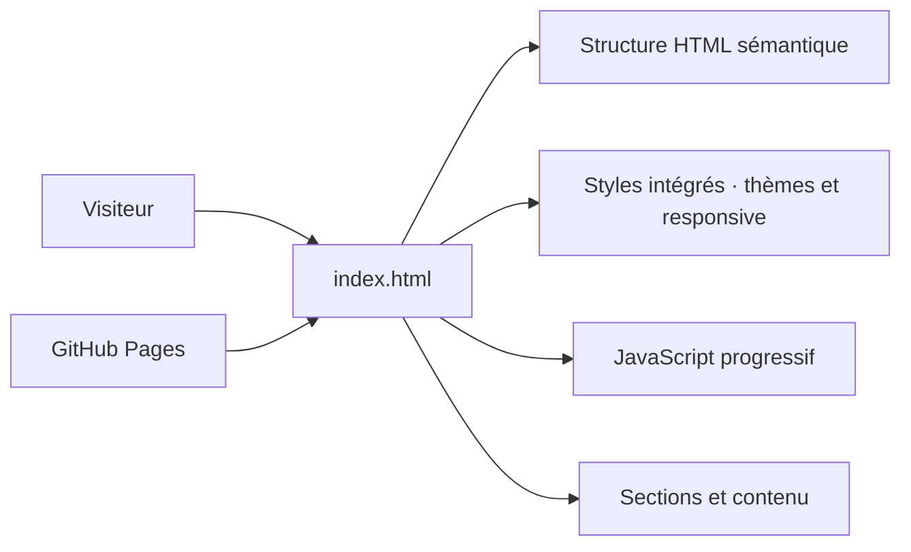

# Architecture du site

> **Entrée principale :** [`../index.html`](../index.html)  
> **Déploiement public :** [teremuhamblin.github.io/README](https://teremuhamblin.github.io/README/)

## Vue d’ensemble

Le site est une page statique autonome. Le balisage HTML, les styles CSS et le JavaScript sont intégrés dans le fichier racine `index.html`. Il n’y a pas de chaîne de compilation requise pour le rendu de base : GitHub Pages peut servir directement le fichier.

## Sections du site

| Identifiant HTML | Rôle |
|:--|:--|
| `synthese` | Présentation générale et domaines. |
| `identite` | Environnements et identité visuelle. |
| `cycle` | Schéma illustrant les étapes et contrôles du travail autorisé. |
| `arsenal` | Familles d’outils et sujets explorés. |
| `operations` | Tableau récapitulatif des projets et statuts déclarés. |
| `validation` | Présentation de la méthode et références affichées. |
| `communications` | Consignes de contact et cadrage des demandes. |

## Comportements d’interface

Le code actuel prévoit notamment :

- thème clair/sombre et mémorisation locale de la préférence ;
- navigation mobile avec état `aria-expanded` ;
- lien d’évitement vers le contenu principal ;
- repérage de la section visible dans la navigation ;
- animations d’apparition avec prise en compte de `prefers-reduced-motion` ;
- mise en page responsive et styles de focus clavier.

Ces comportements doivent être testés après chaque modification, y compris lorsque JavaScript est désactivé ou que le stockage local n’est pas disponible. Le contenu essentiel doit rester compréhensible sans animation.

## Maintenance

- Garder les identifiants de section synchronisés entre la navigation du site et le README.
- Garder les statuts des projets et leurs fiches cohérents.
- Vérifier les liens internes et les liens externes dans un navigateur.
- Ne pas présenter de texte décoratif (par exemple un faux statut ou une simulation de canal sécurisé) comme une fonctionnalité réelle.
- Ne pas publier de références de clients, de prix ou de vulnérabilités sans preuve publique et autorisation.
- Les principes de confidentialité sont décrits dans [`SECURITE.md`](SECURITE.md).

## Limite documentaire

La page web reste la source de référence pour la présentation visuelle. Ce document décrit l’architecture observée et doit être ajusté si le site évolue ; il ne remplace ni un audit d’accessibilité ni une revue de sécurité.
