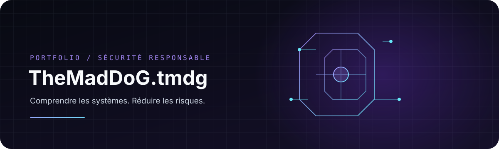

# Identité visuelle du portfolio

## Aperçu

Marque simple disponible également en [version SVG](../assets/brand/mark.svg).

## Direction artistique

Le système visuel associe une base sombre, une touche violette pour les repères identitaires et un cyan mesuré pour les accents fonctionnels. Les formes sont abstraites et géométriques : elles évoquent l’analyse et les systèmes sans représenter une cible réelle ni une capacité opérationnelle.

| Rôle | Couleur | Valeur |
|:--|:--|:--|
| Fond profond | Encre | `#080A12` |
| Surface | Ardoise | `#111827` |
| Accent principal | Violet | `#A78BFA` |
| Accent secondaire | Cyan | `#67E8F9` |
| Texte | Blanc doux | `#F8FAFC` |
| Texte secondaire | Gris clair | `#CBD5E1` |

## Typographie

Pour préserver la compatibilité GitHub, le contenu reste en Markdown standard. Les polices sont choisies par le navigateur ou l’interface de rendu ; les images ne doivent pas contenir de paragraphes ou d’informations essentielles uniquement accessibles sous forme de texte graphique.

## Utilisation des visuels

- Les SVG sont des illustrations autonomes, redimensionnables et sans dépendance externe.
- Conserver le contraste et ne pas communiquer une information par la couleur seule.
- Garder un texte alternatif descriptif lorsque l’image est porteuse de sens.
- Les badges et éléments décoratifs ne constituent pas une certification ou une validation officielle.
- Ne pas ajouter de logos de tiers sans vérifier les conditions d’usage.
