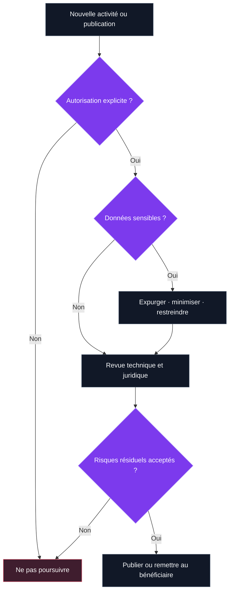

# Sécurité, confidentialité et divulgation

> **Version :** 1.0  
> **Portée :** règles applicables aux publications et contributions de ce dépôt.

## Principes

Le contenu de ce dépôt est destiné à présenter un portfolio, des méthodes de travail et des ressources pédagogiques autorisées. Il ne constitue ni une autorisation, ni une habilitation, ni une invitation à tester un système sans accord explicite.

## Données interdites dans les contenus publics

- Mots de passe, jetons, clés privées ou secrets applicatifs.
- Identifiants et paramètres authentifiants.
- Informations personnelles non nécessaires.
- Adresses internes, topologies, horaires ou coordonnées confidentiels.
- Journaux bruts, captures intégrales ou preuves non expurgées.
- Informations permettant d’atteindre une victime ou un environnement sans autorisation.
- Exploits pleinement automatisés publiés sans mandat et règles de divulgation adaptés.

## Avant de publier

- Vérifier que la publication est autorisée par toutes les parties concernées.
- Identifier les données minimales nécessaires à la compréhension.
- Expurger les preuves et remplacer les valeurs sensibles par des exemples anonymisés.
- Vérifier les liens, résultats, commandes et affirmations de conclusion.
- Décrire les limites du test et son périmètre.
- Prévoir un canal privé pour toute donnée qui ne peut pas être publique.

## Gestion d’un signalement

Toute personne qui découvre un problème de sécurité dans un projet doit :

1. Ne pas publier de preuve active ou de données sensibles dans une issue.
2. Utiliser le canal officiel du propriétaire concerné.
3. Décrire le contexte, les étapes minimales de reproduction et l’impact attendu.
4. Attendre les instructions de responsabilité et ne pas appliquer de preuve destructive.
5. Retirer toute information qui pourrait exposer davantage une cible ou ses utilisateurs.

Ce dépôt ne fournit pas de canal d’urgence. Les personnes concernées doivent consulter les procédures du projet ou du propriétaire réel du système avant toute transmission sensible.

## Divulgation responsable

Lorsqu’une vulnérabilité est confirmée, la publication doit être coordonnée avec les parties concernées. Une divulgation peut être différée pour permettre une remédiation. Toute publication doit préciser :

- La portée du constat.
- Les environnements concernés, dans la mesure autorisée.
- Les limites de reproduction.
- Le statut de correction.
- Les mesures temporaires ou permanentes proposées.
- Les informations volontairement omises pour réduire les risques.

## Checklist GitHub

- [ ] Aucun secret n’est présent dans le texte, les fichiers ou l’historique Git.
- [ ] Les cibles, actifs et identifiants sont anonymisés ou absents.
- [ ] Les commandes sont adaptées à un laboratoire ou à un périmètre autorisé.
- [ ] Les captures sont expurgées.
- [ ] Les liens renvoient uniquement vers des ressources autorisées.
- [ ] Les affirmations sont vérifiables et le statut est exact.
- [ ] Une revue finale a été effectuée avant le commit.
