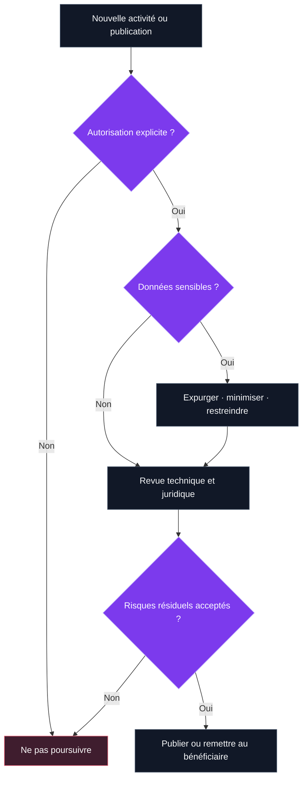

# Sécurité, confidentialité et divulgation

> **Version :** 1.3  
> **Portée :** publications, contributions, projets et ressources de ce dépôt.

## Principes

Le contenu de ce dépôt présente un portfolio, des méthodes de travail et des ressources pédagogiques autorisées. Il ne constitue ni une autorisation d’accès, ni une habilitation opérationnelle, ni une permission d’utiliser une technique contre un système tiers.

Toute activité décrite doit avoir un mandat explicite, un périmètre écrit, des exclusions identifiées et des règles d’arrêt adaptées.



### Attention
```markdown
- données interdites dans les contenus publics : mots de passe, jetons, clés privées ou secrets applicatifs,
- identifiants authentifiants et paramètres sensibles,
- informations personnelles non nécessaires,
- adresses internes, topologies, horaires ou coordonnées confidentiels.
Journaux bruts, captures intégrales ou preuves non expurgées,
- informations permettant d’atteindre une victime ou un environnement sans autorisation,
- exploits pleinement automatisés publiés sans mandat et règles de divulgation adaptés.
Références à des clients, projets ou vulnérabilités sans preuve publique autorisée.
```

### Avant de publier
- Vérifier que la publication est autorisée par toutes les parties concernées.
- Identifier les données minimales nécessaires à la compréhension.
- Expurger les preuves et remplacer les valeurs sensibles par des exemples anonymisés.
- Vérifier les liens, résultats, commandes et affirmations.
- Décrire les limites du travail et son périmètre.
- Prévoir un canal privé pour toute donnée qui ne peut pas être publique.
- Mettre en cohérence le README, index.html, les fiches projets et la documentation.
- Gestion d’un signalement

* *Toute personne qui découvre un problème de sécurité dans un projet doit* :
```markdown
- Ne pas publier de preuve active, payload ou donnée sensible dans une issue.
- Utiliser le canal officiel du propriétaire concerné.
- Décrire le contexte, les étapes minimales de reproduction et l’impact attendu.
- Attendre les instructions de responsabilité et ne pas appliquer de preuve destructive.
- Retirer toute information susceptible d’exposer davantage une cible ou ses utilisateurs.
```

#### Ce dépôt ne fournit pas de canal d’urgence. Les personnes concernées doivent consulter les procédures du projet ou du propriétaire réel du système avant toute transmission sensible.

### Divulgation responsable
#### Lorsqu’une vulnérabilité est confirmée, la publication doit être coordonnée avec les parties concernées. Une divulgation peut être différée pour permettre une remédiation.
